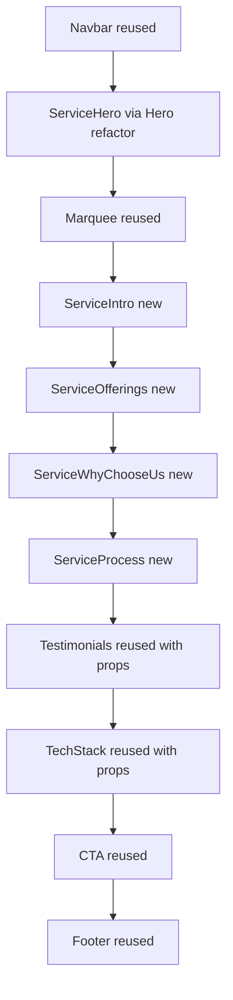

# Service Detail Page — Architecture Plan

Spec source: [`service-detailpage.md`](../service-detailpage.md)
Routing decision: **Dynamic `[slug]` route for all 6 services**
Hero decision: **Refactor [`Hero.tsx`](../src/components/Hero.tsx) to accept optional props** (defaults preserve homepage)

---

## 1. Current State Assessment

| Area | Finding |
| ------ | --------- |
| Routing | No `src/app/services/` directory exists |
| Components dir | No `src/components/services/` subfolder exists |
| Hero.tsx | Fully hardcoded homepage copy; structurally 80%+ identical to required service hero |
| Services.tsx | Cards render but have NO links to detail pages |
| services data | Entries have NO `slug` or `href` |
| Testimonials.tsx | Data hardcoded internally; no props — not truly reusable |
| TechStack.tsx | Data hardcoded internally; no props — not truly reusable |
| Theme | Tokens available: `ink`, `surface`, `line`, `amber`, `text-gradient`, `max-w-content`, `font-display`, `font-body` |
| Design deps | `framer-motion` v13, `lucide-react`, `react-icons`, `next/image` installed |
| Image config | `next.config.js` has NO `remotePatterns` — remote image URLs will fail under `next/image` |

### Asset Inventory (available for new sections)

- `/images/about_us_img1.png`, `/images/about_us_img2.png`
- `/images/about_us img1.png`, `/images/about_us img2.png`
- Service images: `webdevelopement.png`, `customersupport.png`, `Aiandcybersecurity.png`, `socialmediamangement.png`, `billingsolutionimg.png`, `backofficeoperation.png`
- Hero cards: `hero_card_img1.png`, `hero_card_img2.png`, `hero_card_img3.png`
- Portfolio images, avatars, `logo.png`, `hero-bg.jpg`, `hero-texture.png`

**Gap:** Why-Choose-Us needs 6 photos; Service Intro needs 2 photos. Only ~4 usable generic team photos exist. Asset strategy is an open item (see Section 8).

---

## 2. Slug Map

| Service (content.ts title) | Slug | Route |
| ---------------------------- | ------ | ------- |
| Web Development | `web-development` | `/services/web-development` |
| Customer Support | `customer-support` | `/services/customer-support` |
| A.I & Cybersecurity | `ai-cybersecurity` | `/services/ai-cybersecurity` |
| Social Media Management | `social-media-management` | `/services/social-media-management` |
| Billing Solutions | `billing-solutions` | `/services/billing-solutions` |
| Back Office Operations | `back-office-operations` | `/services/back-office-operations` |

---

## 3. Proposed File Structure

```
src/
├── app/
│   └── services/
│       └── [slug]/
│           └── page.tsx              # Server component: generateStaticParams + generateMetadata + notFound
├── components/
│   ├── Hero.tsx                      # REFACTOR: optional props, homepage defaults
│   ├── services/
│   │   ├── ServiceIntro.tsx          # 2-column value pitch + overlapping photos
│   │   ├── ServiceOfferings.tsx      # 6-card capability grid (2x3)
│   │   ├── ServiceWhyChooseUs.tsx    # 6 photo cards (3x2)
│   │   └── ServiceProcess.tsx        # Radial orbit + mobile vertical timeline
│   ├── Testimonials.tsx              # REFACTOR: optional items prop
│   └── TechStack.tsx                 # REFACTOR: optional items prop
└── data/
    └── servicesDetailData.ts         # Typed data for all 6 services
```

---

## 4. Page Composition (Top to Bottom)



---

## 5. Data Architecture — `src/data/servicesDetailData.ts`

Typed interfaces plus a `servicesDetail` record keyed by slug.

```
interface ServiceOffering { icon: string; title: string; description: string; }
interface WhyChooseUsItem { image: string; title: string; description: string; }
interface ProcessStep { number: string; title: string; description: string; angle: number; }
interface IntroPhoto { src: string; alt: string; }

interface ServiceDetail {
  slug: string;
  hero: {
    highlightTitle: string;   // e.g. WEB
    mainTitle: string;        // e.g. DEVELOPMENT
    subtitle: string;
    description: string;
    ctaText: string;
    ctaLink: string;
    cardImages: { src: string; alt: string }[];
  };
  intro: {
    badge: string;
    headingPlain: string;
    headingAccent: string;
    paragraphs: string[];
    photos: IntroPhoto[];
  };
  offerings: { title: string; subtitle: string; tagline: string; items: ServiceOffering[]; };
  whyChooseUs: { titlePlain: string; titleAccent: string; items: WhyChooseUsItem[]; };
  process: { title: string; subtitle: string; steps: ProcessStep[]; };
  testimonials: Testimonial[];   // optional override
  techStack: string[];           // optional override
}

export const servicesDetail: Record<string, ServiceDetail> = { ... }
```

Icons are stored as **string keys** (e.g. `"Globe"`, `"AppWindow"`) resolved to `lucide-react` components inside `ServiceOfferings.tsx` via a local icon map — keeps data serializable and safe for server components.

Web Development content is fully specified in the spec. Other 5 services receive sensible content using the same schema (draft copy in the data file, refined later).

---

## 6. Component Specifications

### 6.1 Hero.tsx Refactor (Option A — recommended)

Add an optional props interface; **all props default to current homepage values** so `page.tsx` remains untouched:

```
interface HeroProps {
  badge?: string;
  highlightTitle?: string;   // default "Unlocking"
  mainTitle?: string;        // default "your Digital Outreach."
  subtitle?: string;         // default undefined (hidden)
  description?: string;      // default homepage paragraph
  ctaText?: string;          // default "Let's Talk"
  ctaLink?: string;          // default "/contact"
  cardImages?: { src: string; alt: string }[];
  showSocialSidebar?: boolean; // default true
}
```

- `ImageStack.tsx` must also gain an optional `images` prop (fallback to current 3 cards).
- `TalkButton.tsx` needs an optional `label` prop (currently hardcodes `"Let's Talk"`) to support `"Get Started"`.
- Service hero hides the vertical social sidebar per spec.

### 6.2 ServiceIntro.tsx (new)

- Badge pill `ABOUT OUR SERVICE` with `ArrowUpRight` (pattern from About.tsx).
- Two-tone heading: plain white + `text-gradient` accent.
- Multi-paragraph body (`text-white/75`).
- Right: 2 overlapping rounded-2xl photos with amber glow border (pattern from AboutImages.tsx).

### 6.3 ServiceOfferings.tsx (new)

- Centered header: title `text-gradient`, subtitle, tagline.
- Grid: `grid-cols-1 sm:grid-cols-2` (2x3 on desktop).
- Card: `rounded-2xl bg-surface border border-white/10 p-6`, hover lift + `hover:border-amber/60`.
- Left icon badge `w-14 h-14 rounded-xl bg-white/5 border border-white/10` + right title/description.

### 6.4 ServiceWhyChooseUs.tsx (new)

- Centered header: `Why` white + `Choose Us?` `text-gradient`.
- Grid: `grid-cols-1 sm:grid-cols-2 lg:grid-cols-3` (3x2).
- Card: `rounded-2xl overflow-hidden bg-[#161616] border border-white/10`.
- Top image `aspect-[16/10]` with `next/image fill` + `object-cover`, bottom `p-6`.

### 6.5 ServiceProcess.tsx (new)

- Desktop: radial orbit. 6 steps at angles 0/60/120/180/240/300 deg.
- Center: concentric rings (`absolute` divs with `rounded-full border` + pulse glow) + `logo.png`.
- Implementation: absolute-positioned nodes computed from angle via CSS `transform: rotate(a) translate(r) rotate(-a)` (no JS layout math) OR SVG.
- Node card: `01` amber number, bold title, muted description.
- Mobile `< 768px`: **vertical connected timeline** with a vertical gradient line.
- Animate orbit ring pulse + staggered node reveal via framer-motion, gated by `useReducedMotion()`.

### 6.6 Testimonials.tsx / TechStack.tsx Refactors

- Add optional `items` / `techStack` props; fall back to in-file defaults when omitted → homepage unchanged.
- **Note:** Testimonials currently uses Unsplash remote URLs not whitelisted in `next.config.js`. Recommend migrating to local `/images/homereview*.png` or adding `remotePatterns`.

---

## 7. Routing — `src/app/services/[slug]/page.tsx`

- Server component (no `"use client"` at page level).
- `generateStaticParams()` returns all 6 slugs from `servicesDetail`.
- `generateMetadata()` sets title/description per service.
- Unknown slug → `notFound()` (uses existing `error.tsx`).
- Composition order per Section 4.
- Client interactivity (framer-motion) lives inside components; page stays server-side.

### Routing wiring

- Add `slug` to each entry in `services` data.
- Wrap service cards in `Services.tsx` with `next/link` to `/services/{slug}`.

---

## 8. Open Items / Decisions Needed

1. **Photo assets for Why-Choose-Us (6) and Intro (2):** Only ~4 generic team photos exist locally. Options: (a) reuse existing local images with varied crops, (b) user supplies new images, (c) add `remotePatterns` to `next.config.js` and use placeholder remote photos.
2. **Non-web-development content:** Draft copy auto-generated from the same schema — confirm if acceptable or if per-service copy will be supplied.
3. **Testimonials remote images:** migrate to local assets vs. add `remotePatterns`.

---

## 9. Verification

- `npm run lint`
- `npm run build` (confirms `generateStaticParams` + server/client boundaries)
- Manual route checks: `/`, `/services/web-development`, invalid `/services/unknown`
- Confirm homepage visual output is **unchanged** after Hero/Testimonials/TechStack refactors
